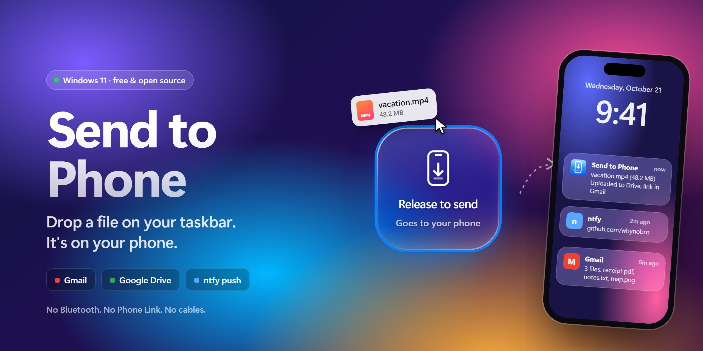
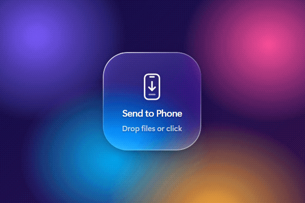
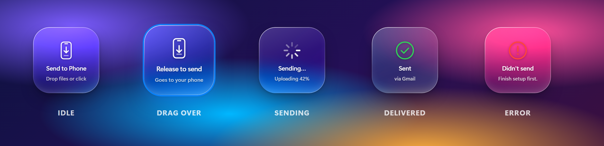
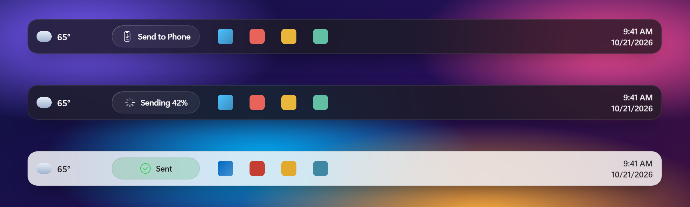
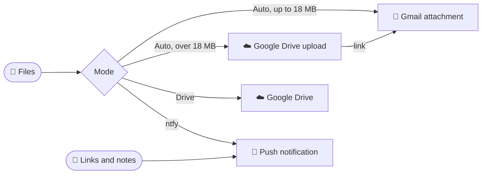

<a href="https://github.com/whynobro/CompToPhoneWidget/releases/latest"></a>

<p align="center">
  <a href="https://github.com/whynobro/CompToPhoneWidget/releases/latest"></a>
  <a href="https://github.com/whynobro/CompToPhoneWidget/releases"></a>
  
  
  <a href="LICENSE"></a>
</p>

<h3 align="center">A little glass drop zone in your Windows 11 taskbar.<br>Drop a file on it. It's on your phone.</h3>

<p align="center">
  <a href="https://github.com/whynobro/CompToPhoneWidget/releases/latest"><b>⬇ Download for Windows 11</b></a>
  &nbsp;·&nbsp; <a href="#-how-it-routes">How it routes</a>
  &nbsp;·&nbsp; <a href="#-setup">Setup</a>
  &nbsp;·&nbsp; <a href="#-for-developers">Developers</a>
</p>

<p align="center"></p>

No Bluetooth pairing. No Phone Link. No cables, no cloud account to create. It uses apps your phone already has (Gmail, Google Drive) or a free push app (ntfy), and it opens in about half a second.

## ✨ Features

| | |
|---|---|
| 🪟 **Lives in the taskbar** | A capsule parked between the weather widget and Start. Hides itself when a game or video goes fullscreen. |
| 🧊 **Or on the desktop** | A 136 px frosted-glass tile that blurs your real wallpaper and flips to dark text on bright backgrounds. |
| 📎 **Any file, any size** | Small files ride as Gmail attachments. Big ones upload to Google Drive and arrive as a link in the same email. |
| 🔗 **Links and notes too** | Drag a link or selected text onto it, or right-click → *Send a note or link*. Lands as an instant push notification. |
| 📶 **Live progress** | Upload percentage right on the widget, plus a check mark (or a clear error) when it's done. |
| 🔒 **Your keys stay home** | The Gmail app password is encrypted with Windows DPAPI. Drive access is limited to files this app uploaded. |

<p align="center"></p>

<p align="center"></p>

## 🧭 How it routes

Pick one delivery mode in Settings. Every file lands in exactly one place, never duplicated.



| Channel | Phone needs | Limit | Notes |
|---|---|---|---|
| **Gmail** | Gmail app | 18 MB per email (bigger batches split) | Needs a Gmail [app password](https://myaccount.google.com/apppasswords) (2-Step Verification on). Files stay in Gmail. |
| **Google Drive** | Drive app | Any size | Uploaded with [rclone](https://rclone.org) to a `From PC` folder, scope `drive.file` (it only sees its own uploads). Connect in Settings opens a Google consent page. |
| **Push (ntfy)** | [ntfy](https://ntfy.sh) app subscribed to your topic | 15 MB per file | Instant, no account. ntfy.sh keeps files about 3 hours. The topic name acts as the password. |

## 🚀 Setup

1. **Download** `Send-to-Phone-Setup-x.y.z.exe` from [Releases](https://github.com/whynobro/CompToPhoneWidget/releases/latest) and run it. It installs for your user only (no admin) and starts right away.
2. **SmartScreen:** the installer isn't code-signed, so Windows says "Windows protected your PC". Click **More info**, then **Run anyway**.
3. **Settings** opens on first run. Pick a mode and fill it in:
   - **Gmail / Auto:** your Gmail address plus an [app password](https://myaccount.google.com/apppasswords).
   - **Google Drive:** `winget install Rclone.Rclone`, then click **Connect** in Settings.
   - **ntfy:** install the ntfy app. Android: scan the QR code in Settings. iPhone: tap **Copy topic** and paste it into ntfy's **+** dialog.
4. Hit **Test** in Settings, then drop something on the widget.

Everything is stored on your PC in `%APPDATA%\Send to Phone`. Uninstall from Settings → Apps.

## 🖱️ Using it

- **Drop** files on the widget, or **click** it to pick files (multi-select works).
- **Send a link or note:** drag a link or text onto it, or right-click → **Send a note or link…** (pre-fills a link from your clipboard; Ctrl+Enter sends, Esc closes). Tapping a link notification on the phone opens it.
- **Right-click** for: Send files, Settings, In taskbar / On desktop, Keep on top and Reset position (desktop), Start with Windows (on by default), Quit.
- **Tray icon:** click it to bring the widget forward.

<details>
<summary><b>🔬 How the taskbar capsule and the glass work</b></summary>

**Taskbar.** Windows 11 has no taskbar add-in API, so the capsule is a topmost window placed with UI Automation ([src/taskbar.js](src/taskbar.js)) in the gap between the Widgets button and Start. It is re-raised every second, hidden while a fullscreen app is active, and re-positioned every 30 s (Start moves when apps are pinned). The last position is saved, so later launches open in place instead of waiting on UI Automation. Errors show as a Windows toast.

**Glass.** Windows 11 acrylic only works on framed windows with 8 px corners, so the desktop tile reads your wallpaper (`TranscodedWallpaper` + `WallpaperStyle` from the registry), aligns it to the tile's screen position, and blurs it in CSS. Text flips dark on bright wallpapers. Wallpaper changes are picked up within 20 s.

**Fast start.** Mail and QR libraries load on first use, the taskbar mode never reads the wallpaper, and the first frame is painted in the right shape.

</details>

## 🛠️ For developers

```sh
npm install
npm start          # launches detached (clears VS Code's ELECTRON_RUN_AS_NODE)
npm test           # sender unit tests, no network
npm run dist       # build dist/Send-to-Phone-Setup-<version>.exe (NSIS, per-user)
npm run media      # re-render docs/media (banner, states, taskbar, demo GIF) from widget.html
npm run icon       # regenerate assets/icon.png + icon.ico
```

If `npm start` fails with a missing `electron.exe`, npm skipped Electron's install script (allow-scripts): run `node node_modules/electron/install.js`.

**Release:** bump `version` in package.json, `npm run dist`, then `gh release create v<version> dist/Send-to-Phone-Setup-<version>.exe`.

**Code map:** [src/main.js](src/main.js) (windows, tray, IPC, settings) · [src/sender.js](src/sender.js) (Gmail, Drive, ntfy) · [src/taskbar.js](src/taskbar.js) · [src/wallpaper.js](src/wallpaper.js) · [src/widget.html](src/widget.html) · [src/settings.html](src/settings.html)

## 📄 License

[ISC](LICENSE) © Michael Fischbach
